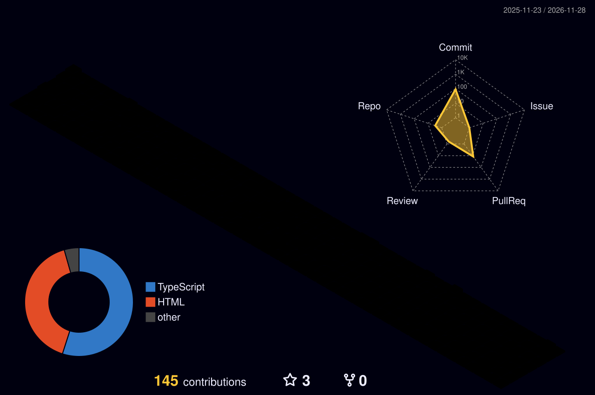

<div align="center">

# < NZ888 />

### Fullstack Developer · AI Engineering

[](https://git.io/typing-svg)

**Building scalable systems, exploring AI and turning ideas into products.**

</div>

---

### 🧠 About Me

```typescript
const developer = {
  focus: ["Backend", "AI", "System Design"],
  stack: ["TypeScript", "NestJS", "Next.js"],
  database: ["PostgreSQL", "Redis", "Prisma"],
  ai: ["RAG", "LLMs", "Vector Search"],
  philosophy: "Build. Learn. Improve."
};
```

### ⚡ Tech Stack

<div align="center">


</div>

### 🚀 Featured Projects

**Drone Shop — Fullstack E-commerce**

Next.js · NestJS · Prisma · PostgreSQL

[Explore Project](https://github.com/NZ888/Nest-Next-Typescript-DroneShop)

**React Redux TypeScript Shop**

React · TypeScript · Redux Toolkit

[Explore Project](https://github.com/NZ888/React-Redux-TypeScript-Shop)

### 📊 GitHub Analytics

<div align="center">





</div>

---

<div align="center">

*Code is a tool. Building something meaningful is the goal.*

</div>
